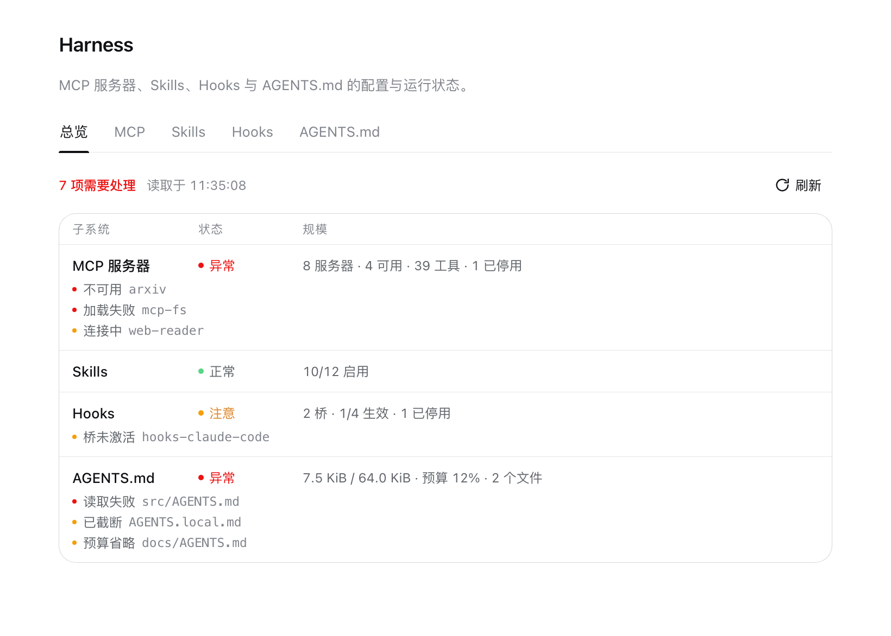
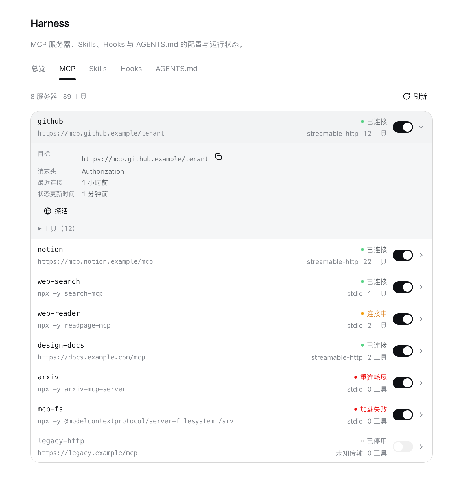
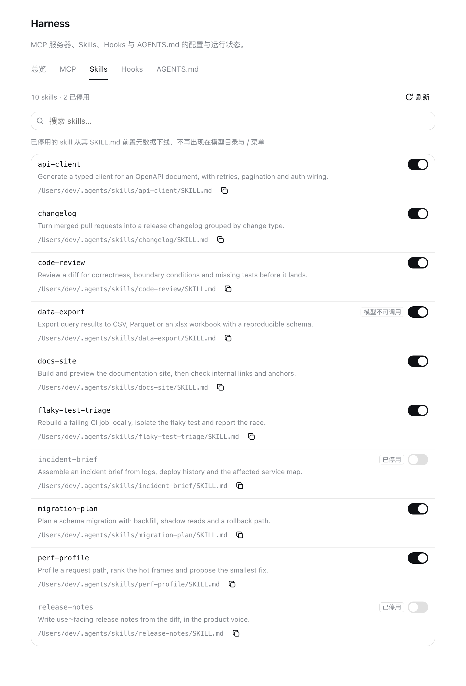
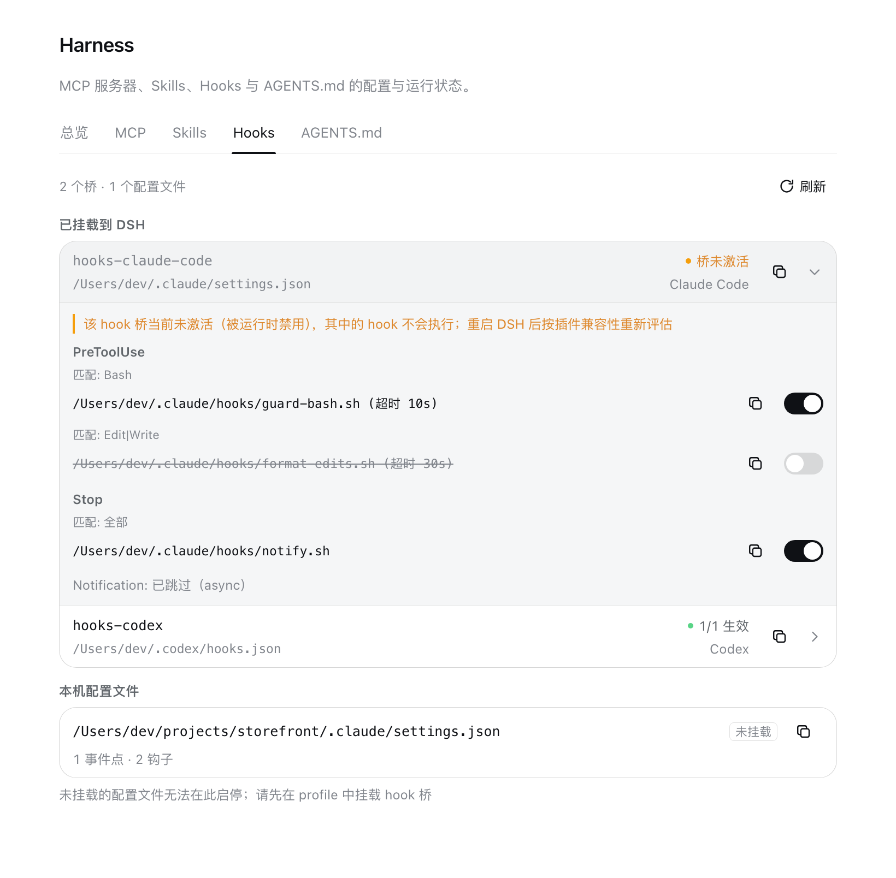
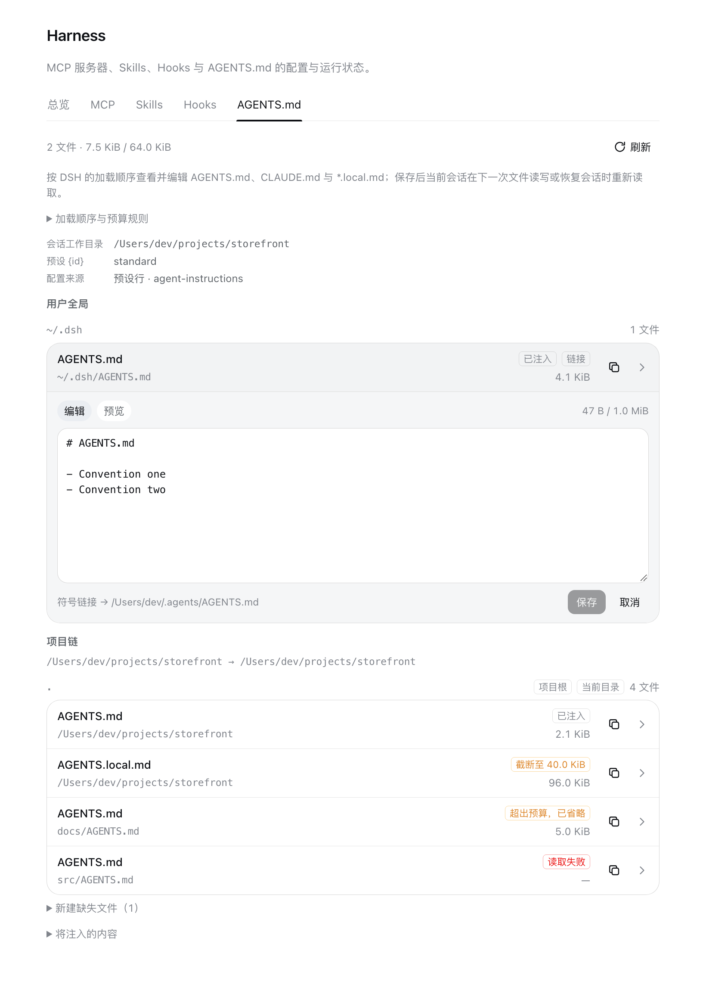
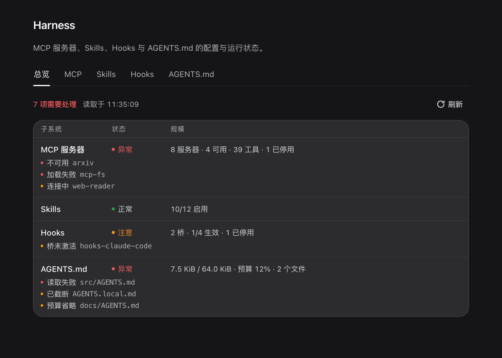

# dsh-harness-panel

**Harness settings for [DeepSeek Harness](https://github.com/deepseek-ai/deepseek-harness).** MCP servers, skills, hooks and the AGENTS.md chain — inspectable, switchable and editable in one panel that looks like it shipped with the app.



<sub>Screenshots come from the repo's preview harness, rendered against fixture data.</sub>

## Install

Desktop profile (`~/.dsh/profiles/desktop`):

```bash
cd ~/.dsh/profiles/desktop
# package.json → dependencies: "dsh-harness-panel": "link:<path to this repo>"
# package.json → dsh.profile.bundles: add "dsh-harness-panel"
pnpm install
# restart DSH (the desktop profile has no live reload)
```

Or install by local path from Settings → Plugins. Requires DSH `>=0.2.0 <0.3.0`.

## MCP



- Start/stop any addressable server through the shipped plugin manager — the same switch the built-in Plugins page uses
- One-shot probe (streamable-http `initialize` POST or stdio spawn, 10s deadline)
- Transport, sanitized target, tool inventory, reconnect facts; env/header **keys** only, never values

## Skills



- The session's `/` catalog plus the host's disabled records, so a switched-off skill stays visible with an off switch
- A switch edits that skill's own `SKILL.md` frontmatter (`user-invocable: false`, `disable-model-invocation: true`), so it leaves the model catalog and the `/` menu in every registry scope
- Search, model-invocable marker, source path

## Hooks



- Mounted Claude Code / Codex bridges parsed into event → matcher → command
- Per-command switch: flips that hook's `type` to the sentinel the bridge skips, then reloads the row
- On-disk configs that exist but are **not** mounted are listed read-only

## AGENTS.md



- The candidate chain in loader order, every file's disposition spelled out: injected, empty, truncated, omitted, duplicate, over the source cap, unreadable, missing
- The loader's own budget algorithm, plus a preview of the text that will actually be injected
- Inline editor on each candidate: allowlisted path, mtime precondition, symlinks written through

## Dark theme



## Design

A status surface, not a dashboard: one framed list per page with hairline rows, tabular figures for counts, monospace for identifiers, semantic color only where something is wrong. Rows are the controls — an expandable row is a button with its switch as a sibling, a whole overview row opens its page, and no "open" control repeats what the row already says. Theme tokens only (`--dsw-*`), so light and dark both work.

## Security boundary

- MCP and hook-bridge switches call the shipped `remote.pluginManager.setPluginEnabled`; this plugin registers no write route for them
- Write routes are `POST /harness-panel/skills/toggle`, `/hooks/toggle-hook` and `/agents/write` — each needs JSON, `x-harness-panel: 1` and a same-origin `Origin`; bodies are capped (16 KiB / 4 MiB)
- A skill toggle touches only the two invocation keys of that skill's own file; a hook toggle only that command's `type`; an AGENTS.md write only a candidate discovered for the requested working directory, with a matching mtime
- Host state is limited to those edits plus `$DSH_HOME/harness-panel/state.json` (0600, names and original lines, no bodies, no credentials)
- Credentials never leave the host: env/header maps surface as key lists, URLs and errors are redacted; routes bind to loopback

## Development

```bash
pnpm install
pnpm typecheck
pnpm test                     # aggregation, parsing, routes, gates, locale parity
pnpm build                    # lib/index.js (host) + lib/client.js (browser)
node tests/smoke-client-bundle.mjs
bun preview/build.ts          # visual harness → preview/dist/index.html
```

`preview/` mounts the real section against fixtures with stand-in atoms — see [preview/README.md](preview/README.md) for the query flags and how the token sheets are vendored.

---

## 中文

DeepSeek Harness 设置面板：MCP 服务器、Skills、Hooks 与 AGENTS.md 指令链一处查看、启停与编辑，视觉与原生设置页一致。

- **总览**：一屏状态表，四行给出状态词、精确规模与待处理项；整行即入口
- **MCP**：状态、传输、脱敏目标、工具清单；通过官方 plugin manager 启停；一键探活
- **Skills**：与会话 `/` 菜单同源的目录；开关直接改该 skill 的 SKILL.md 前置元数据
- **Hooks**：已挂载桥的事件 → 匹配器 → 命令；每条命令独立开关；未挂载配置只读列出
- **AGENTS.md**：按 loader 顺序展示指令链与每个候选的去向，内联编辑，mtime 校验

安装：在 desktop profile 的 `package.json` 加依赖与 `dsh.profile.bundles`，`pnpm install` 后重启 DSH。要求 DSH `>=0.2.0 <0.3.0`。设计取向：状态面而非仪表盘——发丝分隔的列表、等宽数字、只在出错处用语义色，行本身就是控件；只用 `--dsw-*` token，亮暗皆可。
